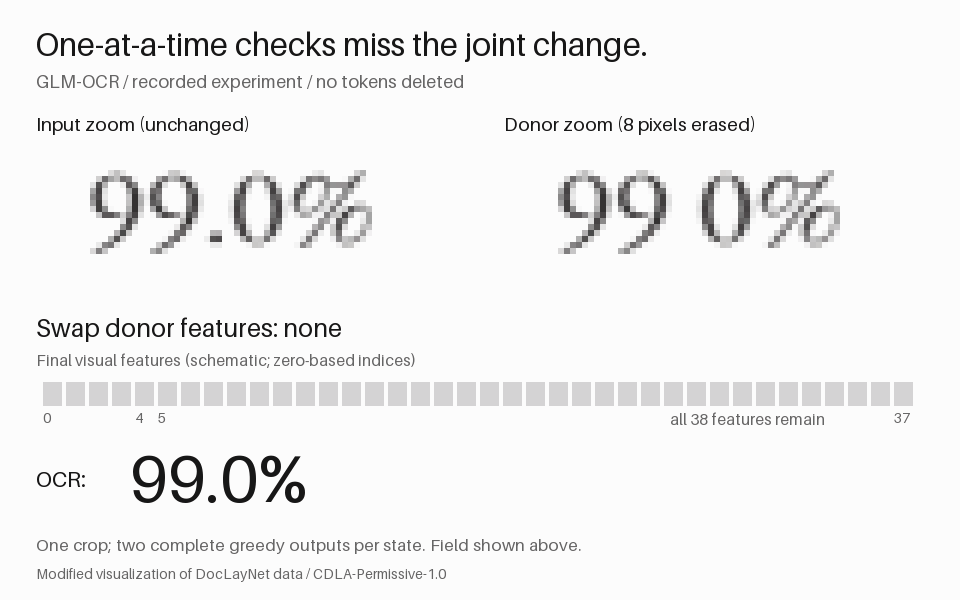

# visTokenOptimizer

Small experiments on GLM-OCR's visual tokens.

**Singleton checks miss a joint change.** Encode the original crop and a
dot-erased donor. Replacing final feature 4 or 5 alone preserves `99.0%`;
replacing both produces `99 0%`. Same original input, all 38 features retained.

One crop, two repeats per condition. Feature swaps, **not token deletion**.
This greedy-output pattern does not prove non-additive logits, a new pruning
method, or a speedup.

[Full recorded outputs + provenance](assets/decimal/results.json).
Redraw the GIF (CPU only; no OCR): `uv run --script scripts/decimal_gif.py`.

Source: [DocLayNet](https://github.com/DS4SD/DocLayNet),
`NYSE_SMFG_2011.pdf`, metadata page 208.
[CDLA-Permissive-1.0](https://cdla.dev/permissive-1-0/).
Cropped and enlarged; donor has eight decimal-point pixels erased.
Method: established [activation patching](https://arxiv.org/abs/2309.16042v2).